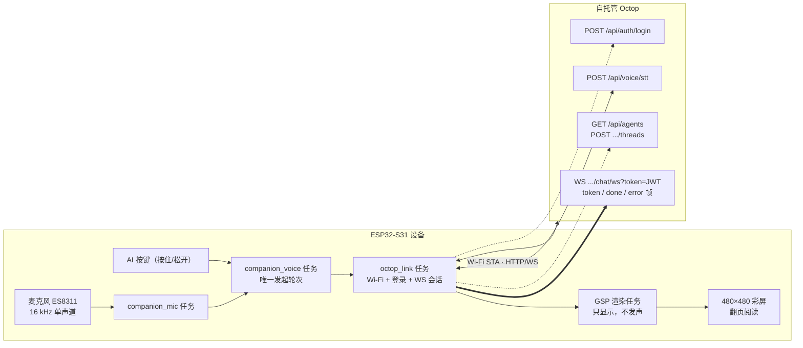
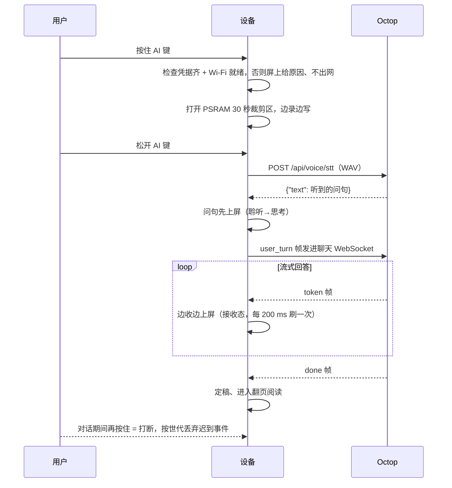
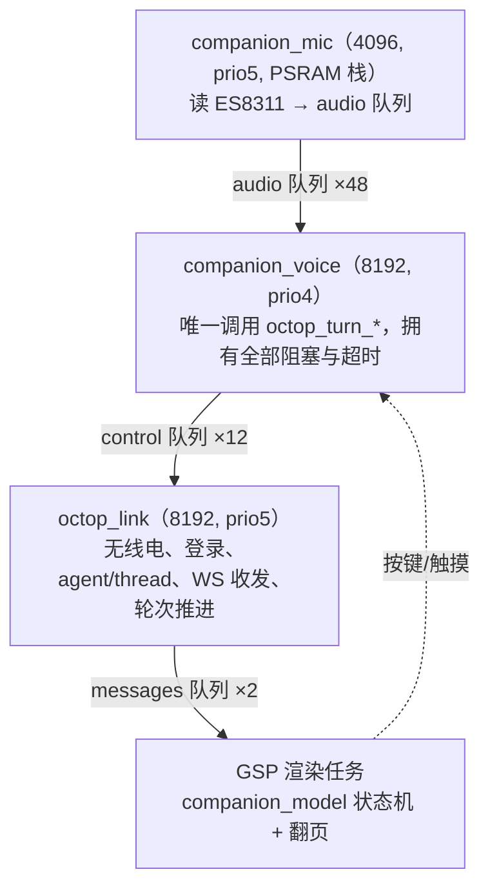
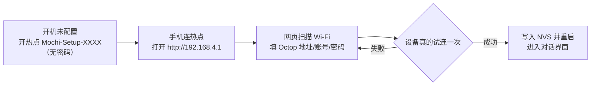

# Octop · Muse ESP-Mosaico 语音伙伴（Octop 后端版）

基于自托管 [Octop](https://github.com/TencentCloud/Octop) 的 ESP-Mosaico 语音 AI 伙伴：按住 AI 键说话，语音由 Octop 内置的 MiMo ASR 识别，智能体流式回答**只显示在屏幕上，不做任何朗读**，长回答靠页内翻页阅读。支持八种角色动态、中英文界面与手机网页配置。


[English](README_EN.md) · [手机配置图文教程](docs/SETUP_CN.md) · [构建](docs/BUILDING.md) · [生成角色](docs/CHARACTERS_CN.md) · [项目说明书](docs/PROJECT_MANUAL_CN.md) · [改造方案与进度](docs/OCTOP_MIGRATION_CN.md)

## 它是怎么工作的

设备是一块 **ESP32-S31（ESP-Mosaico 裸机）**，配 480×480 QSPI 彩屏 + 电容触摸 + 麦克风，**没有喇叭输出**。识别、对话、角色生成都走同一个自托管 Octop 实例，凭据只剩三项：**Octop 地址、用户名、密码**（可选自定义转写地址与 Key）。BLE 配对、Noise 隧道与 TTS 链路已整条下线，设备只需 Wi-Fi 和一个 Octop 账号。

一句话原理：

> 设备把 16 kHz 单声道 PCM 录进 PSRAM 的 30 秒裁剪区，松开按键后 `POST /api/voice/stt` 换回一行文字，再把这行文字作为 `user_turn` 帧发进同一条聊天 WebSocket；Octop 以 `token` 帧流式返回，设备边收边上屏，`done` 帧收尾。所有出网都走设备自己的 Wi-Fi STA，回复只落在屏幕上。

### 架构总览



### 一次对话的端到端时序



### 任务与队列拓扑

运行时是自有的 **3 个任务 + 3 条队列**（详见 [项目说明书 §4](docs/PROJECT_MANUAL_CN.md)）；世代号 `generation` 是并发正确性的唯一来源——迟到的回复/错误因世代不匹配被丢弃。



### 首次配网



保存前设备会真实试连目标网络（最多等 15 s 拿 IP），连不上就整条拒绝、绝不写坏旧凭据。

## 功能

- 黑底奶白色原创角色，待机、聆听、思考、接收、困倦、错误、开心、开机八种动态。
- 上方 AI 键按住说话、松开发送；回答边收边显示，再自动翻页；按住 AI 键可打断。
- 屏显每页约 220 个汉字（按像素排版，非按字数），长回答提供手动 `‹ ›` 翻页与自动翻页间隔（3–15 秒）。
- 首次启动连接设备免密码热点 `Mochi-Setup-XXXX`，网页里扫描并保存 Wi-Fi 与 Octop 账号，保存前设备会真的试连一次。
- 中英文设置；拾音增益、亮度、自动熄屏、翻页间隔可调，设置页底部显示 Octop 会话状态。
- 触摸角色触发开心动画，拿起、触摸或按键唤醒熄屏。
- 支持通过同一条 Octop 通道生成新角色，在电脑预览后更新资源。

## 需要准备

ESP-Mosaico 裸机、USB 数据线，以及一个可访问的自托管 Octop（默认 `http://<服务器地址>:8088`）与它的账号密码。ASR 由 Octop 侧配置，设备端不需要额外 Key。每位使用者填写自己的凭据，仓库与固件不包含作者的服务地址、账号或 Wi-Fi 数据。当前版本不需要扩展插件；不支持视频播放，也没有喇叭输出；自动环境光亮度尚未接入。

## 资源与内存预算

固件把整份 `NotoSansSC` 字体（约 7.4 MB）和 GSP 资源打包进应用，`ota_0` 分区有足够余量；长回答全程驻留 PSRAM 供翻页，不做滚动。

| 项 | 值 | 说明 |
|---|---|---|
| `muse_companion.bin` | 9,982,720 B（`0x985300`） | 含字体与资源包 |
| `ota_0` 容量 | `0xaf0000` = 11,468,800 B | 余量约 1.42 MB；应用装进 `ota_0`，不是 `factory` |
| 录音裁剪区 `CLIP_MAX` | 960 KB（30 s × 16000 × 2 B） | PSRAM，超 30 s 丢弃 |
| 链路回复上限 `REPLY_CAP` | 65536 B | 64 KiB |
| 屏上回复上限 `COMP_REPLY_CAP` | 65536 B | 与链路对齐，约 95 页；超长靠翻页读完 |
| 队列深度 | audio 48 / control 12 / messages 2 | messages 每槽装一整条回答，2 槽已覆盖一次突发 |
| 首帧 / 空闲看门狗 | 45 s / 60 s | 外层 UI 兜底 120 s |
| 流式刷新 | 每 200 ms 一次 | 读起来是"活的"，又不会出现半页 |

> 开机内存基线可在设备日志里读：应用启动时 `companion_runtime_start()` 会打印一行 `runtime start: psram free … internal free …`，用它核对当轮可用堆。

## 直接安装

本仓库**不提供预编译固件**，支持的安装方式是**从源码构建后 system-update**（改造前的旧 Muse 整包已不随仓库分发，请勿用任何历史固件包刷本项目设备）。安装 Python 3.10+ 和 Git，获取代码后在仓库根目录运行：

```powershell
python tools/bootstrap.py
python -m pip install -r requirements.txt
python mosaico.py iris status --all --json
python mosaico.py iris list --project projects/muse_companion --details --json
```

对首次安装或未验证 Recovery 的设备，先运行 `python mosaico.py recover`，按工具提示操作。已有正常应用和可用 Recovery 时，可通过 `python mosaico.py iris test enter-recovery --project projects/muse_companion --timeout 35` 进入 Recovery。

自行构建固件（依赖与提交记录见 [DEPENDENCIES.json](DEPENDENCIES.json)，步骤见 [docs/BUILDING.md](docs/BUILDING.md)）：

```powershell
cd projects/muse_companion
powershell -NoProfile -ExecutionPolicy Bypass -File build_octop.ps1
```

构建产物用 `python mosaico.py iris system-update --project projects/muse_companion` 上机（资源或布局变更必须用 `system-update`；仅代码变更且分区表完全一致才可用 `app-update`）。

首次配置：手机连接屏幕显示的 `Mochi-Setup-XXXX`，无需密码，打开 `http://192.168.4.1`，填写 Wi-Fi 与 Octop 配置；保存重启后即进入对话界面。设置里的"手机配置"可重新进入热点。

## 让本地 Agent 帮你安装

把设备通过 USB 数据线连接电脑，打开可访问本机 USB 的 Codex 或其他本地 Agent，直接发送下面这句话：

> 请将 https://github.com/samyeei/Octop-muse-esp-mosaico 的最新版固件安装到我通过 USB 连接的 ESP-Mosaico：阅读仓库说明，自动下载代码、准备依赖，先用 `projects/muse_companion/build_octop.ps1` 从源码构建，再通过 `mosaico.py iris system-update` 上机，保留设备身份与已有凭据，不要整片擦除 Flash，也不要使用任何历史预编译固件包；安装后检查设备正常启动，并告诉我如何连接设备热点、打开 192.168.4.1 完成首次配置。

Agent 需要本地文件、网络与设备访问能力，可能会提示你授予权限或操作设备进入恢复模式。安装完成后，在手机配置页填写自己的 Octop 地址与账号，详见 [手机配置图文教程](docs/SETUP_CN.md)。

## 验证与限制

改造后的构建、宿主单测与模拟器交互为本仓库的验收口径。核心链路（录音 → Octop 识别 → 流式回答上屏）已在真机验收通过；自建服务端与不同网络环境请在自己的设备上复现一遍。模拟器不会联网，也不会发声。Octop 首包可能慢到十几秒，设备给 45 秒首字等待和 60 秒 token 空闲窗口，超时会在屏上给出原因。完整限制清单见 [项目说明书 §14](docs/PROJECT_MANUAL_CN.md)。

## 开源与依赖

应用源码采用 Apache-2.0，第三方代码和字体保留各自许可证，见 [NOTICE](NOTICE)。后端为 [Octop](https://github.com/TencentCloud/Octop)；平台底座是 [ESP-Mosaico Vibe](https://github.com/esp-mosaico/esp-mosaico-vibe)。早先版本的 Muse Gadget SDK 源码保留在 `projects/muse_companion/vendor/` 仅作回退参考，已不参与构建。内部固件工程名保留 `muse_companion`，公开仓库名为 `Octop-muse-esp-mosaico`。
