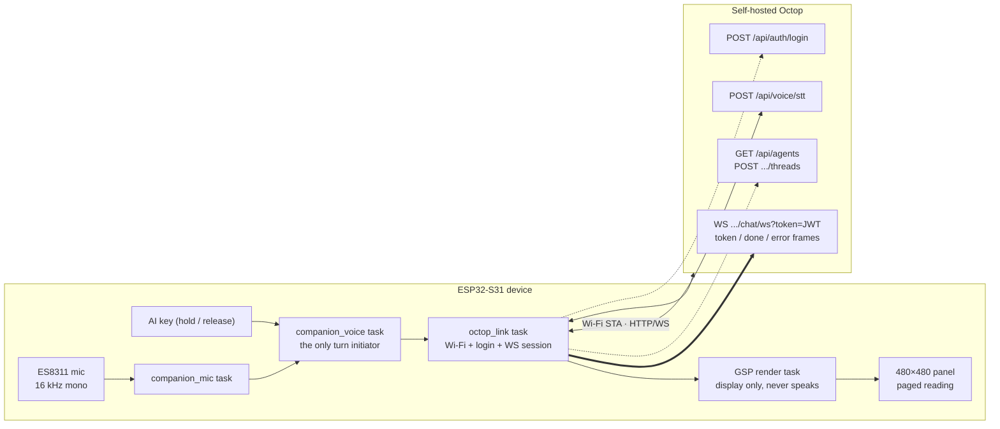
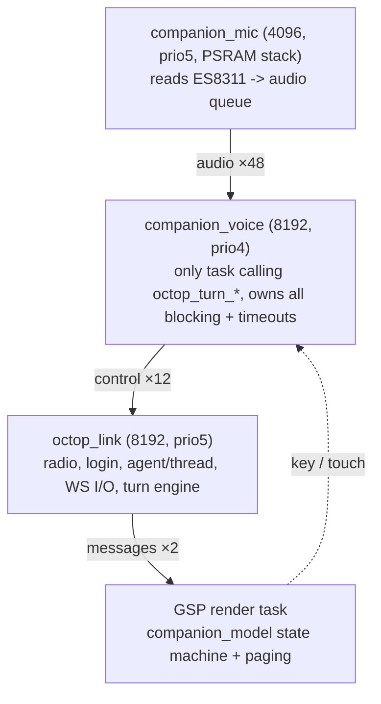
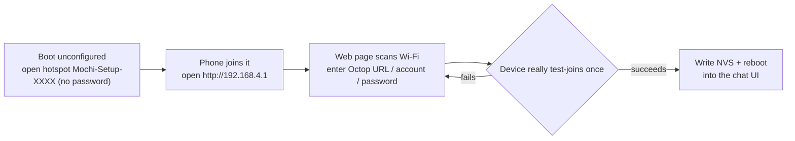

# Octop · Muse ESP-Mosaico Voice Companion (Octop backend)

A push-to-talk AI companion for ESP-Mosaico that talks to your self-hosted [Octop](https://github.com/TencentCloud/Octop). Speech is transcribed by Octop's own MiMo ASR and the agent's answer is **only shown on screen — the device never speaks**, so long replies are read by paging. Eight animated character states, Chinese/English UI, phone-browser provisioning.


[中文](README.md) · [Illustrated setup guide (Chinese)](docs/SETUP_CN.md) · [Build](docs/BUILDING.md) · [Project manual (Chinese)](docs/PROJECT_MANUAL_CN.md) · [Octop migration plan](docs/OCTOP_MIGRATION_CN.md)

## How it works

The device is an **ESP32-S31 (ESP-Mosaico bare board)** with a 480×480 QSPI colour panel, capacitive touch and a microphone — **no audio output**. Transcription, chat and character generation all use one self-hosted Octop instance, so the only credentials are **Octop URL, username and password** (plus an optional custom transcriber URL and key). BLE pairing, the Noise tunnel and the whole TTS path are gone: the device needs Wi-Fi and an Octop account.

In one sentence:

> The board records 16 kHz mono PCM into a 30-second PSRAM clip, then on key release `POST`s it to `/api/voice/stt` to get one line of text, feeds that line as a `user_turn` frame into the same chat WebSocket, and Octop streams the answer back as `token` frames that the device paints as they arrive until a `done` frame closes the turn. Everything leaves over the board's own Wi-Fi STA, and the reply only ever lands on the screen.

### Architecture



### One turn, end to end

```mermaid
sequenceDiagram
    participant U as User
    participant D as Device
    participant O as Octop
    U->>D: Hold the AI key
    D->>D: Gate on credentials + Wi-Fi, else show why and stay offline
    D->>D: Open the 30 s PSRAM clip and record
    U->>D: Release the AI key
    D->>O: POST /api/voice/stt (WAV)
    O-->>D: {"text": transcribed question}
    D->>D: Show the question (listening -> thinking)
    D->>O: user_turn frame into the chat WebSocket
    loop Streaming answer
        O-->>D: token frame
        D->>D: Paint as it arrives (receiving state, refresh every 200 ms)
    end
    O-->>D: done frame
    D->>D: Finalize and enter paged reading
    U-->>D: Holding the key mid-turn interrupts; late events drop by generation
```

### Tasks and queues

The runtime owns **3 tasks + 3 queues** (see [manual §4](docs/PROJECT_MANUAL_CN.md)); the `generation` counter is the single source of concurrency correctness — late replies and errors are dropped on a generation mismatch.



### First-run provisioning



Before saving, the device actually joins the target network (waits up to 15 s for an IP); if that fails it rejects the whole save and never corrupts the existing credentials.

## Features

Hold the top AI key to talk, release to send. The reply streams onto the screen while it arrives and then auto-pages; holding the key again interrupts. Paging is laid out by pixels — roughly 220 Chinese characters per page — with manual `‹ ›` buttons and a 3–15 s auto-page interval. First boot opens the password-free hotspot `Mochi-Setup-XXXX`; the web page scans networks and really test-joins the one you pick before saving. Settings cover microphone sensitivity, brightness, screen-off timeout, paging and language, and show the Octop session state at the bottom. Touching the character plays the happy animation; touch, motion or a key wakes the screen. New characters are generated through the same Octop channel and previewed on your computer.

## Bring your own

An ESP-Mosaico board, a USB data cable, and a reachable self-hosted Octop (typically `http://<host>:8088`) with its credentials. ASR is configured on the Octop side, so the device needs no extra API key. No repository file or firmware image contains the author's server address, account or Wi-Fi data. There is no video playback, no audio output, and ambient-light auto brightness is not wired up yet.

## Resource and memory budget

The firmware bundles the whole `NotoSansSC` font (~7.4 MB) and the GSP resource pack into the app, and `ota_0` has headroom; a long answer stays resident in PSRAM for paging rather than scrolling.

| Item | Value | Notes |
|---|---|---|
| `muse_companion.bin` | 9,982,720 B (`0x985300`) | Includes font + resource pack |
| `ota_0` size | `0xaf0000` = 11,468,800 B | ~1.42 MB headroom; the app installs into `ota_0`, not `factory` |
| `CLIP_MAX` | 960 KB (30 s × 16000 × 2 B) | PSRAM; frames past 30 s are dropped |
| `REPLY_CAP` (link) | 65536 B | 64 KiB |
| `COMP_REPLY_CAP` (screen) | 65536 B | Matches the link (~95 pages); long replies are read by paging |
| Queue depths | audio 48 / control 12 / messages 2 | Each message slot holds a whole answer; 2 covers a burst |
| Watchdogs | 45 s first frame / 60 s idle | Outer UI ceiling 120 s |
| Streaming refresh | every 200 ms | Reads as live, never a half-painted page |

> Boot memory baseline: `companion_runtime_start()` logs a `runtime start: psram free … internal free …` line you can read from the device log to check the free heap for that run.

## Manual installation

This repository ships **no ready-to-flash bundle** — the `firmware/` directory only holds the superseded pre-Octop Muse image, so do not use it for this project. The supported path is **build from source, then system-update**. Install Python 3.10+ and Git, then from the repo root run:

```powershell
python tools/bootstrap.py
python -m pip install -r requirements.txt
python mosaico.py iris status --all --json
python mosaico.py iris list --project projects/muse_companion --details --json
```

For a first-time or unverified-Recovery board, run `python mosaico.py recover` first and follow the prompts. To build the firmware yourself (pinned revisions in `DEPENDENCIES.json`, steps in `docs/BUILDING.md`) run `powershell -NoProfile -ExecutionPolicy Bypass -File build_octop.ps1` from `projects/muse_companion`, then flash with `python mosaico.py iris system-update --project projects/muse_companion`. Use `app-update` only for code changes when the partition table is byte-for-byte identical.

First configuration: join the on-screen `Mochi-Setup-XXXX` hotspot (no password), open `http://192.168.4.1`, and enter your Wi-Fi and Octop settings.

## Install with a local agent

Connect the board over USB and send this to Codex or any local agent that can see your files and USB devices:

> Install the latest firmware from https://github.com/samyeei/Octop-muse-esp-mosaico onto my USB-connected ESP-Mosaico: read the repository instructions, download the code, prepare dependencies, build from source with `projects/muse_companion/build_octop.ps1`, then flash via `mosaico.py iris system-update`. Preserve device identity and existing credentials, do not erase the whole flash, and do not use the stale image under the repository's `firmware/` directory. Verify the device starts normally and explain how to connect to its setup hotspot and open 192.168.4.1 for first-time configuration.

After installation, enter your own Octop address and account on the phone configuration page; see the [illustrated guide (Chinese)](docs/SETUP_CN.md).

## Verification and limits

The Octop build, host unit tests and the interactive simulator are what this repository checks. The core path (record -> Octop recognition -> streamed answer on screen) has been accepted on real hardware; reproduce it on your own server and network. The simulator never goes online and never makes sound. Octop's first token can take more than ten seconds, so the device allows 45 s to start answering and 60 s of token idle time and explains the reason on screen when either expires. Full limits: [manual §14](docs/PROJECT_MANUAL_CN.md).

## Licensing

Application code: Apache-2.0. Bundled third-party code and fonts retain their licenses; see NOTICE. Backend is [Octop](https://github.com/TencentCloud/Octop) on the [ESP-Mosaico Vibe](https://github.com/esp-mosaico/esp-mosaico-vibe) platform. The superseded Muse Gadget SDK sources stay under `projects/muse_companion/vendor/` for rollback only and are no longer built. The internal firmware project remains `muse_companion`; the public repository is `Octop-muse-esp-mosaico`.
